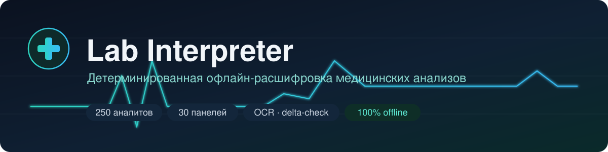
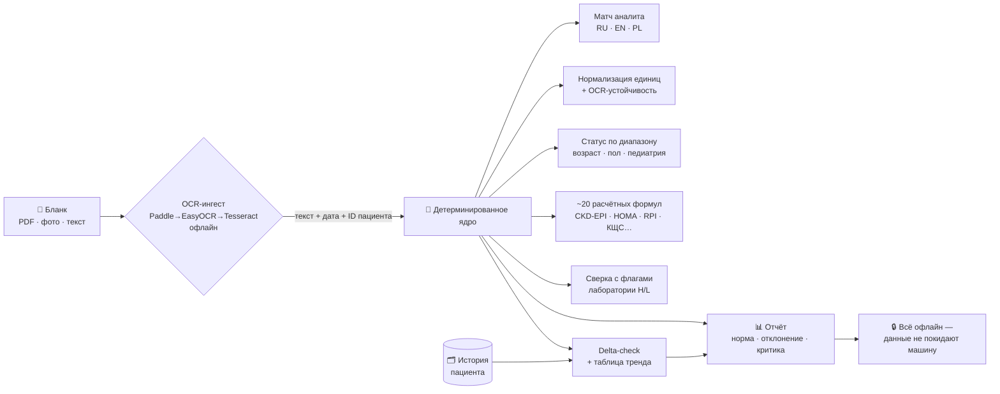

<p align="center">
  
</p>

<p align="center">
  
  
  
  
  
  
  
</p>

## Содержание

- [⚠️ Медицинский дисклеймер](#️-медицинский-дисклеймер)
- [Чем отличается от LLM-обёрток](#чем-отличается-от-llm-обёрток)
- [Как это устроено](#как-это-устроено)
- [Пример](#пример)
- [Структура](#структура)
- [Быстрый старт](#быстрый-старт)
- [Ингест сканов (OCR)](#ингест-сканов-ocr--pdfфото-сразу-в-разбор)
- [Динамика (delta-check)](#динамика-delta-check)
- [Самообучение и обновление](#самообучение-и-обновление)
- [Тесты](#тесты)
- [Вклад и лицензия](#вклад-и-лицензия)

Детерминированный офлайн-инструмент расшифровки медицинских анализов.
**Детерминированное ядро** (парсинг бланка, нормализация единиц, флаги
нормы/отклонения/критики, расчётные формулы) + слой клинической интерпретации
поверх. В отличие от промпт-скиллов-обёрток, статусы считаются арифметически по
реальным данным 250 аналитов, а не «придумываются» моделью на лету.

> ## ⚠️ Медицинский дисклеймер
> Это **инструмент поддержки принятия решений**, а НЕ медицинское изделие.
> Он **не прошёл клиническую валидацию**, **не ставит диагноз** и **не заменяет
> врача**. Референсные диапазоны зависят от лаборатории, метода, популяции,
> возраста и состояния; инструмент даёт ориентир, а решения принимает лечащий
> врач с учётом клиники и анамнеза. Критические значения — повод к срочному
> обращению за медицинской помощью. Используя инструмент, вы принимаете на себя
> все риски (см. LICENSE).

## Чем отличается от LLM-обёрток

- **Детерминизм:** норма/отклонение/критика считаются кодом, воспроизводимо, а
  не генерируются моделью. 250 аналитов с реальными диапазонами в коде.
- **Конверсия единиц** RU/EN/PL (mg/dl ↔ mmol/l, кириллица, OCR-искажения).
- **Возраст и педиатрия** (CKD-EPI / Шварц), ~20 расчётных формул (HOMA, TyG,
  NLR/PLR/SII, RPI, анионный провал, де Ритис, SAAG, критерии Лайта, КЩС…).
- **Delta-check** — динамика по пациенту во времени с порогами значимости (RCV)
  и таблицей тренда. Ловит тренд, который статичный срез скрывает.
- **Сверка с флагами лаборатории** (H/L) и разведение %/абс в лейкоформуле —
  защита от ложной «эозинофилии»/«нейтропении».
- **Приватность:** расшифровка и обучение — полностью офлайн, данные не
  покидают машину. Сеть опциональна и только для обновления справочника.
- **Самопроверка** (`tests/selftest.py`) и **самообучение** синонимам.

## Как это устроено



Ядро (`engine/interpret.py`) зависимостей не требует — чистый Python. OCR и
расширенные движки опциональны. Расшифровка и обучение не выходят в сеть.

## Пример

Небольшой **синтетический** прогон с динамикой и таблицей тренда (спарклайны,
delta-check, сверка %/абс) — в [`docs/EXAMPLE.md`](docs/EXAMPLE.md).

## Структура

```
lab-interpreter/
├── SKILL.md                        # инструкция для AI-ассистента (роль интерпретатора)
├── README.md
├── AUTONOMY.md                     # как пакет развивается/обучается без чата
├── engine/
│   └── interpret.py                # детерминированное ядро + CLI (--learn, overlay, delta)
├── ingest/
│   └── ocr_ingest.py               # OCR-ингест PDF/фото (офлайн, авто дата/пациент)
├── references/
│   ├── reference_ranges.json       # 250 аналитов: синонимы, единицы, диапазоны, критика
│   └── user_overrides.json         # overlay: всё выученное (создаётся learn.py)
├── learn/
│   └── learn.py                    # обучение синонимам из лога (офлайн, self-test)
├── update/
│   └── update.py                   # обновление справочника (сеть, self-test как ворота)
├── tests/
│   └── selftest.py                 # валидация справочника + поведения движка
├── learned/
│   └── unmatched.log               # лог нераспознанного (пишется с --learn)
└── history/
    └── <patient>.jsonl             # история заборов пациента (для delta-check)
```

## Установка как скилл для AI-ассистента

Движок работает и сам по себе (см. ниже). Чтобы подключить как скилл к
AI-ассистенту, скопируйте пакет в его каталог скиллов:

```bash
# Linux/macOS
cp -r lab-interpreter ~/.skills/lab-interpreter

# Windows
xcopy /E /I lab-interpreter %USERPROFILE%\.skills\lab-interpreter
```
Ассистент подхватит скилл при следующем старте; триггеры — в `description`
файла `SKILL.md`. Точный каталог скиллов зависит от вашего ассистента.

## Запуск ядра напрямую

```bash
# текст (по строке на показатель), пол/возраст флагами
python3 engine/interpret.py blank.txt --sex male --age 45

# из stdin, машинный JSON
cat blank.txt | python3 engine/interpret.py - --sex female --json

# свой справочник
python3 engine/interpret.py blank.csv --refs /path/reference_ranges.json
```

Коды возврата: `0` — всё в норме, `1` — есть отклонения, `2` — есть критические.

### Форматы входа (определяются автоматически)

- **Текст:** `Гемоглобин 118 г/л (130-170)` — по строке; контекст строками
  `Пол: муж` / `Возраст: 45` / `Вес: 80`. Качественные — `Белок в моче +`,
  `Нитриты положит`, `Глюкоза в моче отриц`.
- **CSV:** `name,value,unit[,ref_low,ref_high]` — с заголовком или без.
- **JSON:** `{"sex","age","weight","on_anticoagulant","results":[{"name","value","unit","ref_low","ref_high"}]}`.

Единицы — RU или EN, движок приводит к canonical: `ммоль/л`, `mg/dl`, `г/дл`,
`10^9/л`, `тыс/мкл`, `мкмоль/л` и т.д. Если в бланке указан свой референс — он в
приоритете над справочным.

## Возраст и педиатрия

Передай `--age` (в годах, дробный для младенцев: `--age 0.077` ≈ 28 дней). Для
показателей, где возраст меняет норму (ЩФ, Hb, гематокрит, лейкоциты, формула,
креатинин, фосфор, кальций, ГГТ, ТТГ, калий), заданы возрастные полосы от
новорождённых до подростков. Приоритет диапазона: бланк → возраст±пол → пол →
взрослый. Без возраста используются взрослые нормы — для детских бланков возраст
обязателен, иначе ЩФ и Hb дадут ложные отклонения.

```bash
python3 engine/interpret.py blank.txt --sex male --age 5     # ЩФ 300 → норма
python3 engine/interpret.py blank.txt --age 0.027            # новорождённый 10 дней
```

## Что считает ядро

- Статус по каждому показателю: `NORMAL / LOW / HIGH / CRITICAL_LOW /
  CRITICAL_HIGH`, для ОАМ — `POSITIVE / TRACE`.
- Производные: коэффициент де Ритиса, не-ЛПВП холестерин, индекс атерогенности,
  анионный провал, стадия ХБП по СКФ, насыщение трансферрина, глобулины и A/G.
- **Расчётные формулы:** СКФ CKD-EPI 2021 (+стадия ХБП), клиренс по
  Кокрофт-Голту (нужен `--weight`), кальций, скорректированный по альбумину.
- **Guard на ошибки единиц:** значение, многократно превышающее критический
  порог (напр. Hb «118 g/dl» → 1180 g/L), помечается как вероятная опечатка.
- Нераспознанные показатели выносит отдельно — их ассистент разбирает вручную.

## Тесты

```bash
python3 tests/selftest.py
```
Валидирует справочник (диапазоны, множители единиц, дубли синонимов,
непротиворечивость критических порогов) и прогоняет движок на эталонных кейсах
(конверсии единиц, статусы, возрастные пороги, качественные значения,
производные формулы, guard, парсер). Код возврата 0 — всё прошло. Запускай после
каждого изменения справочника или движка.

## Ингест сканов (OCR) — PDF/фото сразу в разбор

```bash
# OCR → интерпретация, дата и пациент извлекаются из бланка автоматически
python3 ingest/ocr_ingest.py blank.pdf --run --sex male --age 26

python3 ingest/ocr_ingest.py blank.pdf            # только OCR-текст
python3 ingest/ocr_ingest.py blank.pdf --meta     # + дата/пациент (JSON)
python3 ingest/ocr_ingest.py scan.png --engine tesseract
```
Полностью офлайн. Движок OCR выбирается автоматически по качеству и наличию:
**PaddleOCR → EasyOCR → Tesseract** (rus+eng+pol) с предобработкой изображения.
Понимает польские бланки (Diagnostyka, ALAB и т.п.): польские названия, запятую
в числах, голые референсы без скобок, флаги H/L, качественные результаты
(niereaktywny/ujemny/dodatni), и типичные OCR-искажения единиц. Дата забора и
ID/PESEL извлекаются сами → delta-check по папке PDF работает автоматически.

## Динамика (delta-check)

```bash
python3 engine/interpret.py v1.txt --patient IVANOV --date 2024-12-20   # первый забор
python3 engine/interpret.py v2.txt --patient IVANOV --date 2025-01-20   # сравнит со всеми прошлыми
```
Показывает только клинически значимые сдвиги (превышающие порог RCV или сменившие
статус норма↔отклонение), фильтруя шум. История — `history/<id>.jsonl`, локально.
`--no-save` — сравнить, но не сохранять прогон.

## Самообучение и обновление

Пакет умеет развиваться без ручной правки. Кратко:
```bash
python3 engine/interpret.py blank.txt --learn   # копить нераспознанное в лог
python3 learn/learn.py review                    # посмотреть + подсказки
python3 learn/learn.py auto                       # автодобавить синонимы (self-test)
python3 update/update.py --from-url <URL>         # обновить справочник (сеть, по желанию)
```
Выученное идёт в `references/user_overrides.json`, базовый справочник не меняется.
Расшифровка анализов — всегда офлайн. Полностью — в `AUTONOMY.md`, включая готовый
промпт для еженедельной запланированной задачи в AI-ассистенте.

## Расширение

Добавь аналит в `references/reference_ranges.json` по существующей схеме. Поля:
`names` (все синонимы RU/EN), `canonical_unit`, `units_accepted` (множители к
canonical), `ranges` (`male`/`female`/`default`), `critical` (пороги или `null`).
Кириллические единицы транслитерируются ядром — хватает латинского варианта.

## Оговорка

Инструмент поддержки принятия решений, не замена врача: не ставит диагноз и не
назначает лечение. Критические значения — повод к срочному обращению за помощью.
